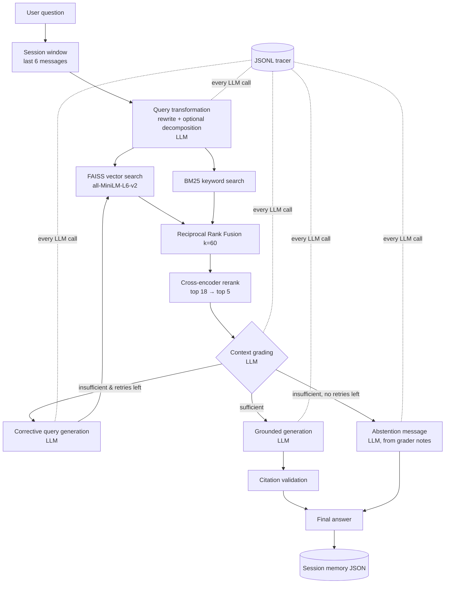

# Advanced RAG Studio
*Intelligent Document Retrieval & Grounded AI*

A Streamlit application that answers questions over a document collection using **five advanced RAG techniques**, a pluggable LLM (**Groq** by default, **Gemini** optional), local embeddings and reranking, full LLM tracing, persistent conversation memory, and a gold-dataset evaluation harness.

## Problem statement
Naive RAG (one vector search, paste the top hits into a prompt) fails on vague, multi-part and follow-up questions, on exact-term queries, and whenever retrieval returns loosely related text, in which case models hallucinate. This project builds each missing safeguard as a separate, inspectable component.

## Key features
| Requirement | Where |
|---|---|
| 1. Query transformation (history-aware rewrite + decomposition) | `src/rag/query_transformer.py` |
| 2. Hybrid retrieval: FAISS + BM25 + Reciprocal Rank Fusion | `src/retrieval/` |
| 3. Cross-encoder reranking (`ms-marco-MiniLM-L-6-v2`) | `src/retrieval/reranker.py` |
| 4. Grounded generation, citations, citation validation, abstention | `src/rag/generator.py`, `src/utils/citations.py`, `src/rag/prompts.py` |
| 5. Corrective RAG (LLM grading → refined query → bounded retry) | `src/rag/context_grader.py`, `src/rag/corrective_rag.py` |
| Bonus: persistent, inspectable session memory | `src/memory/session_manager.py`, Session Memory page |
| Bonus: LLM observability (JSONL traces, tokens, latency, errors, diagnostics) | `src/llm/provider.py`, `src/observability/` |
| Bonus: evaluation harness with gold dataset (+ offline retrieval eval) | `src/evaluation/`, `evaluation/` |
| UI with Dark / Light / Auto themes | `ui/`, `app.py` |

## Architecture


### Pipeline in words
1. **Session context** – the last 6 messages (bounded) are passed to the transformer.
2. **Query transformation (technique 1)** – one `query_rewrite` call decides whether to rewrite (resolving pronouns using history) and whether the question has several independent parts; only then a `query_decomposition` call produces 2-4 subqueries. Malformed output or failure falls back to the original query. Clear questions are returned unchanged.
3. **Hybrid retrieval (technique 2)** – for each query/subquery: FAISS cosine search (20) and BM25 (20). All ranked lists are merged by **RRF**: `score(d) = Σ 1/(k + rank_i(d))`, k=60; chunks found by only one retriever get one term; per-retriever ranks and scores are kept for inspection.
4. **Cross-encoder reranking (technique 3)** – the top 18 fused candidates are scored as (query, chunk) pairs against the rewritten query and every subquery (max score wins); the best 5 go forward. Pre/post-rerank positions and scores are retained. If the model cannot load, the UI shows reranking as **not performed**.
5. **Context grading (technique 5, part 1)** – the LLM judges sufficiency of evidence (not keyword overlap) and returns `relevant`, `score`, `missing_information`, `explanation`. A malformed grader output is flagged `graded=false`, never trusted as a verdict.
6. **Corrective retry (technique 5, part 2)** – if insufficient, the LLM writes a new query targeting the missing information; retrieval, reranking and grading run again. Default max: **1** retry (`max_corrective_retries`). No retry when the first grade passes. Every attempt is recorded.
7. **Generation or abstention (technique 4)** – sufficient → grounded answer with citations; still insufficient → an LLM-written abstention message based on the grader's notes (no outside knowledge, no citations). The generator may also abstain itself (`abstain: true`).
8. **Citation validation** – every `[Source: file, Chunk: id]` is checked against the chunks actually supplied. Unknown ids are removed (and reported); wrong filenames/pages are repaired; an un-cited non-abstaining answer is flagged. PDF page numbers are included when available.
9. **Memory** – user and assistant messages (with sources and pipeline metadata) are persisted.

## Design decisions
- **Why hybrid retrieval**: dense search captures meaning but blurs exact terms (acronyms, ids); BM25 is the opposite. Running both raises recall.
- **Why RRF**: cosine scores and BM25 scores are on different scales; RRF uses only ranks, needs no tuning or training, and rewards chunks found by both retrievers.
- **Why a cross-encoder**: it reads query and passage together, giving better precision than bi-encoder similarity; it only runs on ~18 candidates so cost stays small. Fusion improves recall, reranking improves precision (see the honest measurement caveat in *Evaluation results*).
- **Why corrective retrieval**: a similarity score cannot tell if a passage *answers* the question. An LLM grader can, and its "missing information" note lets the retry change the query rather than repeat it.
- **Grounding & citations**: the system prompt forbids outside knowledge, separates "sources state" from "can be inferred", demands exact-format citations, and requires abstention. Validation in code means a fabricated citation cannot reach the UI.
- **Abstention**: decided by the grader (before generation) *and* by the generator – not by a score threshold alone.
- **Memory**: one JSON file per session (`data/sessions/`), unique ids, isolated per browser session via `st.session_state`; a bounded window is used for follow-ups; history is never treated as evidence.
- **Embeddings**: `sentence-transformers/all-MiniLM-L6-v2`, local – no extra key or quota, reproducible, 384-d, good for small English corpora. The model id is stored in the index metadata and a mismatch forces a rebuild.
- **Reranker**: `cross-encoder/ms-marco-MiniLM-L-6-v2`, local, small and strong on passage ranking.
- **LLM provider choice**: the provider is an interface (`LLMProvider`), so the pipeline is provider-independent. **Groq with `qwen/qwen3.8-27b` is the default** because it is the provider that was verified live end to end during development. During testing with the project's Gemini key, `gemini-2.5-flash` returned 404 (not available to that key/project), while `gemini-3.6-flash` and `gemini-3.8-flash` intermittently returned 503 "high demand" / 504, so a full live Gemini run was never completed. Gemini remains fully implemented as an optional provider (`LLM_PROVIDER=gemini`). Model availability and free-tier quotas depend on each API account.
- **Prompts** live in `src/rag/prompts.py`, each with a role, JSON output schema and anti-hallucination rules (query rewrite, decomposition, context grading, corrective query, grounded answer, abstention, evaluation judge); every model output is parsed defensively with safe fallbacks.
- **Observability**: all calls pass through `TracedLLM` (`src/llm/provider.py`), which writes one JSONL record per call to `logs/llm_calls.jsonl`: id, timestamp, model, call type, prompt, response, tokens, latency, status, error, session, and diagnostics. Token counts are provider-reported `usage`; when absent they are estimated (~4 chars/token) and flagged `tokens_estimated: true`. Transient 5xx/network errors get bounded exponential backoff; 429s, auth and 404 errors are never retried. Hidden SDK retries are disabled so every HTTP request is accounted for. API keys are scrubbed from logs.

## Evaluation methodology
`evaluation/dataset.json` has 18 questions: direct factual, calculation, multi-part, multi-hop, cross-document, a history-dependent follow-up and 3 unanswerable ones. Each has reference answer, expected documents, keywords and an answerable flag.

**End-to-end evaluation** (`evaluation/run_evaluation.py`, Evaluation page) feeds each question through the real pipeline and computes:
- **Answer correctness (heuristic)** – keyword recall ≥ 0.6 (else token-F1 ≥ 0.4 if no keywords) and not abstained; also exact match and token F1. Not an objective truth measure.
- **Answer correctness / faithfulness (LLM judge, optional)** – the LLM compares against the reference / checks claims against retrieved context. Reported separately; if the judge call fails the metric shows `n/a`, never a made-up number.
- **Retrieval** – Precision@K, Recall@K, Hit@K, MRR over the K=5 chunks given to the generator (document-level labels).
- **Citation validity** – cited ids that exist in the retrieved set ÷ all citations (removed invalid ones count against it).
- **Abstention accuracy** – on unanswerable questions; plus the false-abstention rate on answerable ones.

**Offline retrieval evaluation** (`evaluation/run_offline_eval.py`, also a button on the Evaluation page) runs the real local retrieval stack with **zero LLM calls**: the raw question is the query (no rewrite/decomposition), answerable history-free questions only (14 of 18).

### Evaluation results
Offline retrieval, 14 questions, K=5, 53 chunks (**local, 0 LLM calls**; run with `python evaluation/run_offline_eval.py`):

| Retrieval variant | Precision@5 | Recall@5 | Hit@5 | MRR |
|---|---|---|---|---|
| FAISS vector only | 0.557 | 1.000 | 1.000 | 0.964 |
| BM25 only | 0.400 | 0.964 | 1.000 | 0.917 |
| Hybrid (RRF) | 0.514 | 1.000 | 1.000 | 0.964 |
| Hybrid + cross-encoder | 0.500 | 0.964 | 1.000 | 0.964 |

**How to read this honestly:** on a 15-document corpus with document-level labels, every variant already finds a relevant document in the top 5 (Hit@5 = 1.0), so the table **does not demonstrate a measurable advantage** of hybrid search or reranking. Precision@5 is capped because most questions have only one relevant document while five chunks are returned. A meaningful comparison needs a larger corpus and chunk-level labels (see Future improvements). The techniques are implemented and exercised end to end; this measurement simply cannot separate them here.

**Live end-to-end evaluation: not run.** The full dataset and the LLM judge were intentionally not executed live (API quota). See *Verification status* for what *was* verified live.

## Verification status
| Area | Status | Evidence |
|---|---|---|
| Unit/integration tests (local models + mocked LLM, no network) | **346 passing** | `python -m pytest -q`; details and the 14 fixes found by the QA audit in [`FINAL_QA_REPORT.md`](FINAL_QA_REPORT.md) |
| Groq live: factual answer with valid citation | **Verified live** | `transcripts/sample_run.md` (session 1) |
| Groq live: query rewrite + decomposition (2 subqueries) | **Verified live** | same transcript |
| Groq live: follow-up rewrite using memory (pronoun resolved) | **Verified live** | same transcript (partial turn) |
| Groq live: corrective loop (grade → refine query → retry → re-grade) | **Verified live** (retry still insufficient; success-after-retry not observed) | same transcript |
| Groq live: abstention message, persisted in session | **Verified live** | transcript session 2 |
| Groq live: token usage, latency, request ids in JSONL | **Verified live** | `logs/llm_calls.jsonl`, Observability page |
| Gemini provider | Implemented; **not verified end to end live** (404 / intermittent 503, 504) | failures recorded in logs |
| Full live evaluation, LLM judge | **Not run** | – |
| Real 429 quota handling | Mocked only | `tests/test_groq_provider.py`, `tests/test_observability.py` |
| Streamlit UI | Loaded and navigated in Dark, Light, Auto; a live chat turn through the UI was **not** exercised | manual |
| PDF ingestion with text | Corrupt/blank PDFs tested; a real text PDF was not tested | `tests/test_ingestion.py` |
| Screenshots | Not committed | – |

## Project structure
```
app.py                  Streamlit entrypoint, navigation, theme switch
src/config.py           settings (env + defaults)      src/bootstrap.py  service wiring (no Streamlit)
src/llm/                provider interface, TracedLLM (retry/tokens/tracing), Groq + Gemini clients, factory
src/ingestion/          loader (PDF/TXT/MD), chunker, indexer (KnowledgeBase: FAISS+BM25+metadata)
src/retrieval/          vector_store, bm25_retriever, hybrid_retriever (+RRF), reranker
src/rag/                prompts, query_transformer, context_grader, corrective_rag, generator, pipeline
src/memory/             session_manager        src/observability/  tracer, metrics, diagnostics
src/evaluation/         scoring (deterministic), evaluator, offline retrieval eval   src/utils/  text helpers, citations
ui/                     theme tokens, CSS, components, pages/ (chat, KB, inspector, evaluation, observability, memory)
evaluation/             dataset.json, run_evaluation.py, run_offline_eval.py
data/documents/         15-document sample corpus   data/indexes/ FAISS + metadata (generated, git-ignored)
tests/                  pytest suite (no API key needed)
transcripts/            sample_run.md (live), illustrative_mock_run.md (mock), builders
```

## Setup
Prerequisites: Python 3.11+ (developed on 3.12); internet for the first run (downloads two small Hugging Face models, ~120 MB).
```bash
python -m venv .venv
source .venv/bin/activate        # Windows: .venv\Scripts\activate
pip install -r requirements.txt
cp .env.example .env             # then set GROQ_API_KEY (https://console.groq.com/keys); or LLM_PROVIDER=gemini + GEMINI_API_KEY
```
Run the app (the sample corpus is indexed automatically on first launch):
```bash
streamlit run app.py
```
Tests (no API key or quota used):
```bash
python -m pytest -q
```
Offline retrieval evaluation (no API calls):
```bash
python evaluation/run_offline_eval.py
```
End-to-end evaluation (uses your LLM key; ~3-6 calls/question; use `--no-judge` and `--limit 5` for free tiers; mind per-minute token limits):
```bash
python evaluation/run_evaluation.py --no-judge --limit 5
```

### Configuration reference (`.env`)
| Variable | Default | Purpose |
|---|---|---|
| `LLM_PROVIDER` | `groq` | `groq` (default) or `gemini` (optional). Only the selected provider's key/model are used; the other's config can stay in `.env`. |
| `GROQ_API_KEY` | – | Required when `LLM_PROVIDER=groq`. Scrubbed from traces (`gsk_…` pattern and exact value). |
| `GROQ_MODEL` | `qwen/qwen3.8-27b` | Groq model id. Availability differs per account (`llama-3.3-70b-versatile` returned 404 for the verified key). List yours with `GET https://api.groq.com/openai/v1/models`. Free-tier limits are per account (e.g. 8,000 tokens/minute was observed for this model). |
| `GEMINI_API_KEY` | – | Required when `LLM_PROVIDER=gemini`. Never logged. |
| `GEMINI_MODEL` | `gemini-2.5-flash` | Model id; set to one your key can use. A 404 is reported as "model not available to this key". |
| `GEMINI_THINKING_LEVEL` | unset | `minimal`/`low`/`medium`/`high` (Gemini 3-style). Set at most one of level/budget. Support depends on the model. |
| `GEMINI_THINKING_BUDGET` | unset | Token budget for Gemini 2.5-style models (`0` = off). |
| `LLM_MAX_OUTPUT_TOKENS` | `2048` | Output cap for answer generation (provider-neutral). Falls back to `GEMINI_MAX_OUTPUT_TOKENS` when unset. Thinking tokens count toward the cap on reasoning models. Must be ≥ 1. |
| `LLM_MAX_OUTPUT_TOKENS_SHORT` | `1024` | Output cap for JSON utility calls (rewrite, decomposition, grading, corrective query, judge). Falls back to `GEMINI_MAX_OUTPUT_TOKENS_SHORT`. |
| `GEMINI_MAX_OUTPUT_TOKENS` / `GEMINI_MAX_OUTPUT_TOKENS_SHORT` | – | Legacy names for the two caps above (still honoured). |
| `LLM_MAX_RETRIES` | `2` | Bounded backoff retries for 5xx/network errors only. `0` = none (each logical call = one HTTP request). |

If a call ends with the length limit before producing text, the error says so and tells you to raise the cap.

### Failure diagnostics
Calls in `logs/llm_calls.jsonl` carry a `diagnostics` object: HTTP status, provider error status/message/details, an allow-listed set of response headers (e.g. `x-request-id`, `x-goog-request-id`, `retry-after`, `x-ratelimit-*`), the finish reason and thinking-token count. API keys, cookies and auth headers are never copied, and prompt text is never placed in diagnostics. The Observability page shows it per call. A 503 `UNAVAILABLE` ("high demand") is provider-side capacity, distinct from a 429 quota error or a 401/403 key problem.

## Sample questions
- What is the default value of k in Reciprocal Rank Fusion?
- Explain how hybrid retrieval and reranking work together, and why both are needed.
- Why can a similarity threshold alone not prevent hallucinations?
- *(follow-up)* And why is that needed?
- *(unanswerable)* What is the monthly price of a managed Pinecone subscription?

## Sample transcript
[`transcripts/sample_run.md`](transcripts/sample_run.md) is built only from genuine recorded live Groq runs (`python transcripts/build_live_transcript.py`). It contains a factual answer with decomposition and a valid citation, a follow-up resolved through memory with a live corrective loop (partial: the run hit the request cap before the final message), and a live abstention. [`transcripts/illustrative_mock_run.md`](transcripts/illustrative_mock_run.md) is a clearly labelled **mock** illustration (real local retrieval, scripted LLM text) kept only to show scenarios not captured live; it is not evidence of live behaviour.

## Screenshots
No screenshots are committed. Launch the app and switch Appearance (Auto / Dark / Light) in the sidebar.

## Known limitations
- A full live evaluation, the LLM judge, and a live Gemini end-to-end run were not completed (provider quota/availability during development). Real 429 handling is verified with mocks only.
- A *successful* corrective retry (retry finds sufficient evidence) and citation repair/removal were not observed in live runs.
- The sample corpus is small (15 documents, 53 chunks) and relevance labels are document-level, so the retrieval metrics saturate and cannot show the benefit of hybrid search or reranking.
- Reasoning models spend hidden tokens within the output cap; caps are configurable, and a length-limited empty response is reported with a hint.
- Free-tier limits (e.g. 8,000 tokens/minute on the tested Groq model) can throttle evaluation; a question uses 3-6 LLM calls (~1,000-token grading prompts).
- Scanned PDFs (no text layer) are rejected; no OCR.
- Exact (flat) FAISS index; BM25 is rebuilt in memory on load. No authentication (local single-user app).

## Future improvements
Chunk-level gold labels and a larger corpus, a live full-dataset evaluation with the judge, streaming answers, semantic chunking, async LLM calls, claim-level faithfulness checks on every answer, optional web-search fallback for corrective RAG, approximate FAISS indexes for large corpora, committed screenshots.
